<picture><source media="(prefers-color-scheme: dark)" srcset="https://raw.githubusercontent.com/EduardoCoura/EduardoCoura/output/city-dark.svg" /><source media="(prefers-color-scheme: light)" srcset="https://raw.githubusercontent.com/EduardoCoura/EduardoCoura/output/city-light.svg" /></picture>

  <a href="https://github.com/EduardoCoura/EduardoCoura/issues/new?template=testimonial.yml"><picture><source media="(prefers-color-scheme: dark)" srcset="https://raw.githubusercontent.com/EduardoCoura/EduardoCoura/output/link-testimonial-dark.svg" /><source media="(prefers-color-scheme: light)" srcset="https://raw.githubusercontent.com/EduardoCoura/EduardoCoura/output/link-testimonial-light.svg" /></picture></a>

<!-- testimonials:start -->
<!-- testimonials:end -->

 

  <samp>Analista de Segurança | CyberSecurity | AI Engineer</samp>
    
  

 

  
  
  
  
  
   
  
  
  

 

  

 

  
   
  
   
  

